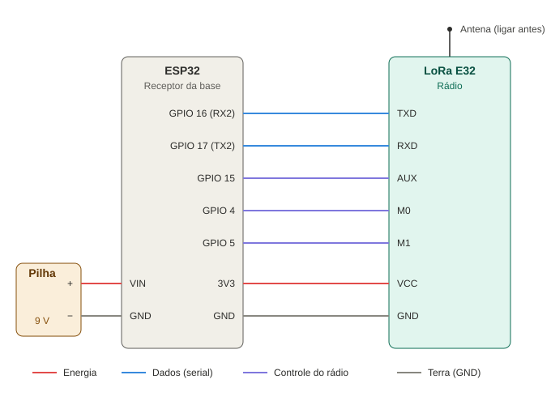

# Receptor (base): pinagem e ligações

Pinagem do sketch `RECEPTOR_COM_WEB/RECEPTOR_COM_WEB.ino`, o que recebe os pacotes LoRa e os envia ao backend por Wi-Fi.
Origem no código: `LoRa_E32 e32ttl(&Serial2, 15, 4, 5)` e `Serial2.begin(9600, SERIAL_8N1, 16, 17)`.

## Ligações ESP32 ↔ módulo LoRa E32

| Módulo E32 | ESP32 | Observação |
|---|---|---|
| TXD | GPIO 16 (RX2) | TX do rádio vai no RX do ESP (cruzado) |
| RXD | GPIO 17 (TX2) | RX do rádio vai no TX do ESP (cruzado) |
| AUX | GPIO 15 | Indica rádio ocupado/pronto |
| M0 | GPIO 4 | Seleção de modo |
| M1 | GPIO 5 | Seleção de modo |
| VCC | 3V3 | Nunca no VIN/5V quando a placa é alimentada por 9 V |
| GND | GND | Terra comum |

## Alimentação com pilha de 9 V (somente bancada)

- Pilha **+** no pino **VIN** do ESP32; pilha **−** no **GND**.
- O VCC do E32 sai do pino **3V3**, não do VIN: com 9 V no VIN, esse pino fica com 9 V e queima o rádio (limite típico do E32: ~5 V).
- Não ligue a pilha e o cabo USB ao mesmo tempo.
- Uma pilha alcalina de 9 V tem pouca carga (~500 mAh) e o Wi-Fi gera picos de corrente: duração de cerca de 1 a 2 h e risco de reinício por queda de tensão. Para uso contínuo, prefira power bank ou fonte USB de 5 V.

## Cuidados

- Ligue a **antena** antes de energizar o rádio.
- O transmissor precisa do mesmo canal e velocidade no ar (1,2 kbps) do receptor; o receptor grava essa velocidade na inicialização.
- Configure `SSID` e `PASSWORD` no topo do sketch antes de gravar, sem commitar credenciais reais.
- Os pinos de GPS (22 e 23) são só do transmissor.

> Montagem deduzida do código; não foi validada em bancada. Confirme o modelo da placa ESP32 e do E32 (tensão máxima e posição dos pinos).
